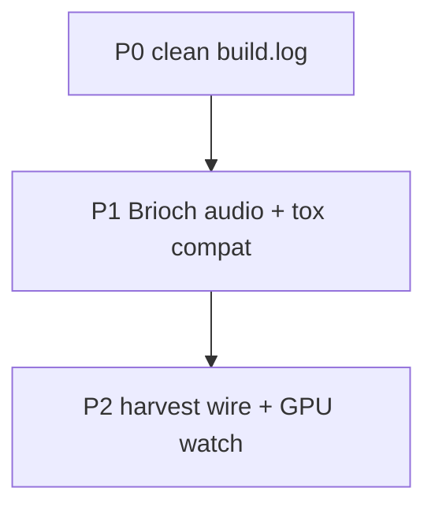

# BRIKVJ master plan (bugs · features · code · sessions)

**North star:** Resolume-class VJ on TD **2023.12370**, one `.toe`, Brioch + harvest + lab, Ableton/Patchworks optional.

**SSOT:** `Documents\TouchDesigner\BRIKVJ\` · **Kit:** `TouchDesigner/brikvj/` · **Fork:** briksquared/iKeleton-OSC

---

## 0. Bootstrap every session

```powershell
TouchDesigner/brikvj/scripts/brikvj_research_pass.ps1
# or full: brikvj_session_start.ps1
```

Read: `logs/RESEARCH_PASS.md` → `logs/OPEN_WORK_QUEUE.md` → `logs/BUG_SCAN.md` → [RESEARCH_PASS_PLAN.md](RESEARCH_PASS_PLAN.md) (12-session deep) → this file.

**TD launches:** user allows **one** minimized/headless-style run per build ([AGENT_TD_POLICY.md](AGENT_TD_POLICY.md)). No `-help` probes on `TouchDesigner.exe`.

---

## 1. Bug closure program (order)



| Phase | Close when | Commands / files |
|-------|------------|------------------|
| **P0** | No Traceback in `build.log`; mega save OK | Fix [BUG_REGISTRY](BUG_REGISTRY.md) B-LOG-*; `run_once_unattended.ps1 -ForceResolumeRebuild -AllowTouchDesignerLaunch` **once** OR Textport `TEXTPORT_MEGA.txt` |
| **P1** | td_errors trending down; newer tox managed | RB-001; `patch_brikvj_quiet_open.ps1`; MOTU 3–4 |
| **P2** | FX wires quiet; GPU dialog not recurring | Rebuild; Windows GPU preference for TD |

---

## 2. Feature program (Resolume parity)

Source: [USER_REQUESTS.md](USER_REQUESTS.md), [FEATURE_MATRIX.md](FEATURE_MATRIX.md) (refresh counts from code), [RESEARCH_BACKLOG.md](RESEARCH_BACKLOG.md).

| Phase | Features | How ([ADD_FEATURES.md](ADD_FEATURES.md)) |
|-------|----------|------------------------------------------|
| **F1 Show core** | Scenes 20+, FX 28+, clip deck, router, perform keys | `brikvj_resolume_stack.py` + `brikvj_perform_controls.py` — **done in kit;** refresh toe |
| **F2 Harvest** | +14 scene picks, curated unwired (123→−10) | `brikvj_harvest_scene_expansion.py`; score in DEEPER §6 |
| **F3 Lab** | Lazy Hydra RB-004; tools router 2 | `brikvj_research_lab.py` cook on switch only |
| **F4 Live** | TDA mapper RB-005; Ableton link RB-006 | One bridge per session; **no** `live_levels` in mega |
| **F5 Polish** | Presets, record UI, hub index | `brikvj_preset_bank.py`, `brikvj_hub_index.py` |

**Feature gate:** no new `.tox` without `TOX_BUILDS` check + loader entry + WORKLOG line.

---

## 3. Code review checklist (kit Python)

Run each planning sprint (no TD required):

| Check | Command / action |
|-------|------------------|
| Syntax | `python -m compileall scripts` |
| TD API strings | Prefer `td_create_op()` for DAT types in build scripts |
| Mega steps | Each `brikvj_*.py` top-level `run()` should not throw (try/except or guard) |
| Paths | `ROOT = Documents\...\BRIKVJ` in runners; sync before TD |
| Inject safety | `patch_brikvj_quiet_open.ps1` size guard before collapse |
| Stale docs | Recount `SCENE_DEFS`/`FX_DEFS` → update FEATURE_MATRIX |
| Dead scripts | `_deprecated/` not in `old_brik_vj_mega.py` STEPS |

**Review queue (next):** `brikvj_ableton_link.py`, `brikvj_research_lab.py` (cook cost), `fix_brikvj_brioch_toe.ps1`.

---

## 4. Six-session roadmap

| Session | Goal | Deliverable |
|---------|------|-------------|
| **S1** | P0 bug closure | Clean `build.log`; gap exit 0 |
| **S2** | P1 audio + dialogs | td_errors ↓; user confirms quiet open |
| **S3** | F2 integrate 3 tox | RESEARCH_DIFF picks; RB-003 progress |
| **S4** | F3 lazy lab | RB-004 design + partial impl |
| **S5** | F4 one Live bridge | RB-005 or RB-006 smoke |
| **S6** | Docs + matrix | FEATURE_MATRIX from code; BUG_REGISTRY all fixed/mitigated |

---

## 5. Research & discovery (ongoing)

| Channel | Script / doc |
|---------|----------------|
| Unwired tox | `brikvj_research_diff.ps1` |
| Gaps | `brikvj_gap_report.ps1` |
| Bugs | `brikvj_bug_scan.ps1` |
| Sweep archive | `scan_harvest_for_brikvj.ps1` |
| Intent drift | USER_REQUESTS vs WORKLOG |
| Transcript | DEEPER §4.4 |

---

## 6. Headless / unattended build (user-approved)

**One process**, minimized window, `dismiss_td_dialogs.ps1` sidecar:

```powershell
scripts\sync_scripts_to_documents.ps1
scripts\run_once_unattended.ps1 -ForceResolumeRebuild -AllowTouchDesignerLaunch
scripts\remove_brikvj_autostart_from_toe.ps1
scripts\verify_brikvj_stack.ps1
scripts\brikvj_bug_scan.ps1
```

Not a loop. If exit ≠ 0, fix kit and ask user before second launch.

---

## 7. Document map

| Doc | Role |
|-----|------|
| [PLAN_INDEX.md](PLAN_INDEX.md) | TOC |
| [MASTER_PLAN.md](MASTER_PLAN.md) | This file |
| [BUG_REGISTRY.md](BUG_REGISTRY.md) | Bug SSOT |
| [NEXT_SESSION_PLAN_DEEPEST.md](NEXT_SESSION_PLAN_DEEPEST.md) | Execute queue |
| [NEXT_SESSION_PLAN_DEEPER.md](NEXT_SESSION_PLAN_DEEPER.md) | Discovery meta |
| [ADD_FEATURES.md](ADD_FEATURES.md) | How to add |

Last updated: 2026-10-29.
