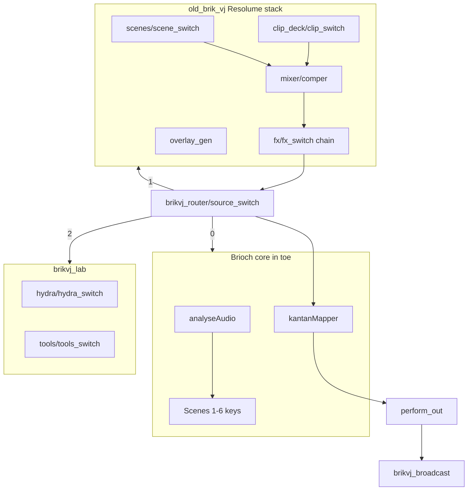

# BRIKVJ — deep next-session playbook

**Audience:** a new Cursor chat with no memory.  
**Quick path:** [NEXT_SESSION_PLAN.md](NEXT_SESSION_PLAN.md) (short). **This file:** architecture, discovery trees, research protocol, backlog by subsystem.

**Start command:** `scripts/brikvj_gap_report.ps1` → `logs/GAPS_REPORT.md` → `scripts/brikvj_research_diff.ps1` → `logs/RESEARCH_DIFF.md`.

**Deepest command checklist:** [NEXT_SESSION_OPERATIONS.md](NEXT_SESSION_OPERATIONS.md) (sprints, milestones, failure matrix).

---

## 1. Mental model — what BRIKVJ is

BRIKVJ is **not** a single `.toe` in git. It is three layers:

| Layer | Location | What it holds |
|-------|----------|----------------|
| **Live perform** | `Documents\TouchDesigner\BRIKVJ\` | `BRIKVJ.toe`, synced `scripts/`, `parts/`, `logs/`, `media/`, `assets/` |
| **Git kit** | `TouchDesigner/brikvj/` in `briksquared/iKeleton-OSC` | Source scripts, harvest packs, docs, log snapshots |
| **Harvest archive** | `Desktop\GitHub\audio\ableton\github\_sweep3\touchdesigner` (+ SOURCES.md) | Thousands of clones; only indexed subsets copy into `parts/` |

**User modes (all in one mega stack):**

- **Show** — `perform_out` → kantanMapper → broadcast/projectors; keys + router; Brioch scenes 1–6 + harvest `scene_switch`.
- **Practice** — clip_deck, presets, `brikvj_lab/tools`, recorders.
- **Research / dev** — `brikvj_lab/hydra/*`, `parts/harvest_pick/`, Hydra modules, KodeLife, fulldome sim; router index **2**.

---

## 2. Runtime graph (TouchDesigner)



**Operator map:** `op('brikvj_hub').text`, `KEYBOARD_MAP.md`, `\\` cycles router 0→1→2.

---

## 3. Build pipelines (which script when)

| Pipeline | Entry | Steps | When to use |
|----------|--------|-------|-------------|
| **Mega** | `old_brik_vj_mega.py` / `TEXTPORT_MEGA.txt` | 26 scripts, non-fatal errors | Default; show+practice+research |
| **Fast** | `old_brik_vj_fast.py` / `TEXTPORT_FAST.txt` | Resolume core only | Quick FX/scene refresh |
| **All-in-one** | `old_brik_vj_all_in_one.py` | Delegates to mega | Legacy name, same as mega |
| **Suite** | `brikvj_suite_build.py` | Older okVJ-heavy path | Avoid unless debugging suite-only |
| **Unattended** | `run_once_unattended.ps1 -ForceResolumeRebuild` | Injects autostart → mega → save → quit | TD **closed**; agent-driven |

**Shared helpers:** `brikvj_td_helpers.py` — `td_load_tox()`, `TOX_BUILDS.json` skip, `HEAVY_TOX_SKIP`.

**After any unattended build:** `remove_brikvj_autostart_from_toe.ps1` (keeps `brikvj_dialog_prefs` if re-injected by remove script + quiet kantan).

---

## 4. Deep discovery — decision tree

Use when `GAPS_REPORT.md` is green but the show still feels wrong, or user asks “what’s missing?”.

```
START → brikvj_gap_report.ps1
  │
  ├─ Toe < 2 MB? ──YES──► run mega unattended (TD closed)
  │
  ├─ build.log Traceback? ──YES──► open log, identify script, fix, re-run from that step or full mega
  │
  ├─ User sees N dialogs on open?
  │     ├─ "Error" / operator ──► patch_brikvj_quiet_open.ps1; check kantan execute1.text (no force cook)
  │     └─ "newer .tox" ──► Preferences Accept; td2023 resaves; TOX_BUILDS skip
  │
  ├─ verify_brikvj_stack FAIL? ──YES──► missing op paths → re-run integrate + mega
  │
  ├─ td_errors Brioch NoneType? ──YES──► audiodevin1 3-4; analyseAudio mp3 paths (fix_brikvj_brioch_toe)
  │
  ├─ Feature gap vs Resolume? ──YES──► FEATURE_MATRIX.md + VJ_FEATURE_PARITY.md → map to harvest role
  │
  └─ New GitHub clones? ──YES──► scan_harvest_for_brikvj.ps1 → sync_harvest_from_index → tox scan → wire in Python
```

---

## 5. Research protocol — find work, then do it

### Phase A — Inventory (no TouchDesigner)

1. `scan_harvest_for_brikvj.ps1` → `HARVEST_INDEX.json` (`priorityPicks`, role tags).
2. `scan_tox_build_versions.ps1` → `parts/TOX_BUILDS.json` (`newerThanHost`).
3. Diff: compare `HARVEST_PICK.json` file list vs what mega actually loads (`brikvj_resolume_stack.py` SCENE_DEFS/FX_DEFS, `brikvj_harvest_scene_expansion.py`, `brikvj_research_lab.py`).
4. Read `FEATURE_MATRIX.md`, `RESOLUME_MAP.md`, `HARVEST_PLAYBOOK.md` — **note:** matrix may predate mega; trust code + WORKLOG over stale counts.

### Phase B — Candidate evaluation (per .tox)

| Check | Tool | Pass criteria |
|-------|------|----------------|
| Exists in sweep | `Test-Path` under `_sweep3/touchdesigner` | File present |
| TD version | toeexpand → `.build` | `build 2023.xxxxx` or resaved under `parts/*/td2023/` |
| Role fit | HARVEST_INDEX roles | Matches gap (e.g. missing `record_out`) |
| Load safety | `td_load_tox` in isolation | No dialog when pref set; else skip or resave |
| Perform cost | Manual judgment | Not `fluid_3d_grid` class crashes |

**Integrate:** add to `sync_harvest_*.ps1` map → resync → add to SCENE_DEFS/FX_DEFS or lab loader → mega build → verify.

### Phase C — Ableton / Live side

- `ableton/ABLETON.md`, `PATCHWORKS_INTEGRATION.md`, `fix_ableton_tda_paths.ps1`, `install_ableton_harvest_place.ps1`.
- Compositions under `Documents/.../BRIKVJ/ableton/` (not always in git).
- Test **one** bridge per session: `brikvj_tda_mapper_bridge.py` OR `brikvj_ableton_link.py` (live_levels historically crashed TD).

### Phase D — Document the decision

Append to [RESEARCH_BACKLOG.md](RESEARCH_BACKLOG.md) (status: candidate / integrated / rejected + reason).

---

## 6. Backlog by subsystem (actionable)

### 6.1 Startup / UX (P0)

| ID | Task | Owner script | Done when |
|----|------|--------------|-----------|
| S1 | No force cook on open | `inject_kantan_boot.py`, `patch_brikvj_quiet_open.ps1` | `execute1.text` has empty `onStart` |
| S2 | Dialog prefs | `inject_brikvj_dialog_prefs.py` | User opens toe, 0 modals |
| S3 | Remove build autostart daily | `remove_brikvj_autostart_from_toe.ps1` | No `brikvj_build_autostart` in toc |
| S4 | Dismiss during unattended | `dismiss_td_dialogs.ps1` | Bound in `run_once_unattended.ps1` |

### 6.2 Build / save (P0)

| ID | Task | Done when |
|----|------|-----------|
| B1 | Mega completes | `build.log` has `[BRIKVJ mega] project.save() OK` |
| B2 | Autostart blob fits | inject does not raise `onStart too long` |
| B3 | verify passes | `verify_brikvj_stack.ps1` exit 0 |

### 6.3 Resolume stack (P1)

| ID | Task | File |
|----|------|------|
| R1 | Dedupe FX_DEFS (duplicate kaleid/bloom) | `brikvj_resolume_stack.py` |
| R2 | Fix switch input wiring warnings | same + build.log |
| R3 | Scene count vs perform keys hi=31 | `brikvj_perform_controls.py` |
| R4 | Expand harvest_pick scenes beyond 14 | `brikvj_harvest_scene_expansion.py` |

### 6.4 Compatibility (P1)

| ID | Task | File |
|----|------|------|
| C1 | td2023 resaves for loaded okVJ | `resave_tox_for_td2023.py` |
| C2 | Expand TOX_NEWER_BUILD_SKIP from index | `brikvj_td_helpers.py` |
| C3 | Mac path audit | `audit_brikvj_toe.ps1`, `fix_brikvj_brioch_toe.ps1` |

### 6.5 Lab / research (P2)

| ID | Task | Notes |
|----|------|-------|
| L1 | Lazy-load Hydra (don’t cook 32 on open) | Defer lab cook; switch index only |
| L2 | Second scene bank COMP | Optional `old_brik_vj/scenes/bank_b` |
| L3 | Fulldome / record UI labels | `brikvj_hub_index.py` |

### 6.6 Live / Patchworks (P2, risky)

| ID | Task | Risk |
|----|------|------|
| P1 | TDA mapper bridge | Medium |
| P2 | Ableton link | Medium |
| P3 | live_levels_drive | **High** — removed from fast path for crash |

### 6.7 Repo / product (P3)

| ID | Task |
|----|------|
| G1 | Dedicated BRIKVJ repo (REPO_POLICY) |
| G2 | Dated toe backup to `H:\` or user backup — not fork |

---

## 7. Evidence standards (agent supervisor)

Never claim “fixed” or “done” without **this session**:

| Claim | Required evidence |
|-------|-------------------|
| Stack built | `build.log` tail with save OK |
| Verify | `verify_brikvj_stack.ps1` output |
| Quiet open | User report OR kantan text read + patch applied |
| Git saved | `git log -1` + `git push fork` success |
| Harvest added | File in `parts/` + entry in sync script + mega log line |

---

## 8. Session templates

### 2-hour “finish P0”

1. gap_report → sync → patch quiet open if needed  
2. unattended mega (TD closed)  
3. remove autostart → verify → gap_report  
4. commit/push + WORKLOG entry  

### 4-hour “more stuff”

1. P0 above  
2. `brikvj_refresh_all.ps1`  
3. Research Phase A–B: pick 5 tox → integrate 2 safe ones  
4. Update FEATURE_MATRIX or RESEARCH_BACKLOG  
5. commit/push  

### Research-only (no TD)

1. Re-index harvest, diff picks vs loaders  
2. Update RESEARCH_BACKLOG + proposed SCENE_DEFS patch (PR-style diff)  
3. commit docs only  

---

## 9. Key paths cheat sheet

```
Documents SSOT:
  BRIKVJ.toe
  scripts/old_brik_vj_mega.py
  logs/build.log | boot_trace.txt | td_errors.txt | GAPS_REPORT.md
  parts/{generative,harvest_pick,research,extra,vj_suite,glitch_fluid}

Git kit:
  TouchDesigner/brikvj/
  fork: git@ github.com/briksquared/iKeleton-OSC

Harvest source:
  audio/ableton/github/_sweep3/touchdesigner
  audio/ableton/SOURCES.md

Patchworks SSOT (external):
  patchworks/source/manuals/51-old-brik-vj.md
```

---

## 10. Context recovery

| Source | ID / path |
|--------|-----------|
| Cursor transcript | `a38c1ae0-2c81-46db-8e9e-4ef553e7f5be` |
| User personal store | `BRIKVJ_NEXT_CHAT.md` |
| User requests | [USER_REQUESTS.md](USER_REQUESTS.md) |
| Errors encyclopedia | [ERRORS.md](ERRORS.md) |

---

## 11. New-chat prompt (deep)

```text
You are continuing Old Brik V J (BRIKVJ). Read TouchDesigner/brikvj/NEXT_SESSION_PLAN_DEEP.md fully.

1) Pull briksquared/iKeleton-OSC main.
2) Run scripts/brikvj_gap_report.ps1; read logs/GAPS_REPORT.md.
3) Execute P0 from section 6.1–6.2 (quiet open, mega save, verify) with evidence after each step.
4) If time: pick highest-value item from RESEARCH_BACKLOG.md using section 5 protocol.
5) Update WORKLOG.md + RESEARCH_BACKLOG.md; commit and push fork.

Live SSOT: C:\Users\briks\Documents\TouchDesigner\BRIKVJ. Never ask me to paste Textport. TD closed for unattended build.
```

---

## 12. Doc maintenance

When mega stack changes, update in same PR:

- [WORKLOG.md](WORKLOG.md) (dated bullet)
- [FEATURE_MATRIX.md](FEATURE_MATRIX.md) (counts/paths)
- [BUILD.md](BUILD.md) (entry points)
- This file §6 if backlog IDs close

Last deep plan revision: 2026-10-29.
