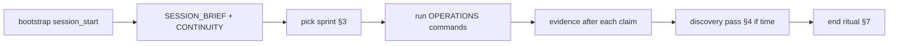
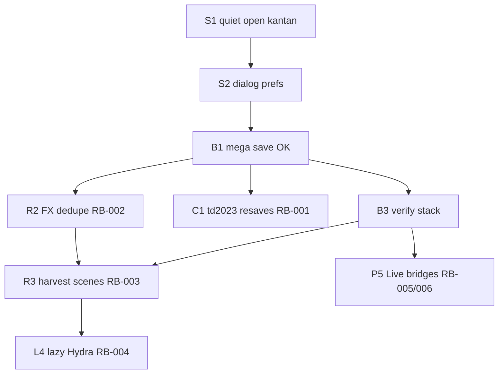

# BRIKVJ — deeper continuity playbook (meta layer)

**Audience:** any new Cursor chat with zero memory, including *you* after a cap reset.  
**Purpose:** finish what is not done, **discover** work that is not yet on any list, **research** harvest/sweep/Live sources, then **execute** with evidence — in a repeatable loop.

**Document ladder:**

| Level | File | Role |
|-------|------|------|
| 0 | Personal store `BRIKVJ_NEXT_CHAT.md` | One command + paste prompt |
| 1 | [PLAN_INDEX.md](PLAN_INDEX.md) | TOC |
| 2 | [NEXT_SESSION_PLAN.md](NEXT_SESSION_PLAN.md) | 5-minute triage |
| 3 | [NEXT_SESSION_PLAN_DEEP.md](NEXT_SESSION_PLAN_DEEP.md) | Architecture + research protocol |
| 4 | [NEXT_SESSION_OPERATIONS.md](NEXT_SESSION_OPERATIONS.md) | Commands, sprints, failure matrix |
| **5** | **This file** | Autonomous loop, discovery engine, closure graph, end-of-session ritual |
| Queue | [RESEARCH_BACKLOG.md](RESEARCH_BACKLOG.md) | RB-xxx |
| State | [logs/CONTINUITY.json](logs/CONTINUITY.json) | Machine snapshot (from `brikvj_session_start.ps1`) |

**Always start with:**

```powershell
TouchDesigner/brikvj/scripts/brikvj_session_start.ps1
```

Then read **`logs/SESSION_BRIEF.md`** → **`logs/CONTINUITY.json`** → execute the sprint the snapshot recommends.

---

## 1. The autonomous session loop

Every session is the same shape. Do not skip steps 5–7 even if the user only asked for one fix.



**Evidence rule (non-negotiable):** cite a command exit code, log line, file size, or git hash from **this session**. See DEEP §7 and OPERATIONS milestone table.

---

## 2. What “finished” means (two bars)

| Bar | User need | Milestones | Stop when |
|-----|-----------|------------|-----------|
| **Show-ready** | Perform Brioch + Resolume stack, no modal spam | M1–M4 | GAPS empty, verify 0, build.log mega save OK, user confirms quiet open |
| **Lab-ready** | Research router 2, harvest expansion, docs | M1–M4 + RB-003/004 partial | Lazy Hydra or acceptable cook cost; RESEARCH_DIFF unwired trending down |
| **Live-ready** | Ableton/Patchworks | M5 | One bridge stable; **never** bundle with live_levels |
| **Kit-ready** | Next chat can continue | M6 | fork pushed, WORKLOG dated, CONTINUITY fresh |

You are **not** trying to wire all ~125 unwired tox or resave all newer builds in one session. You **are** trying to move one closure-graph node per session minimum (§5).

---

## 3. Sprint picker (algorithm)

Use **`logs/CONTINUITY.json`** fields first; override only if the user’s message names a different priority.

```
IF user message names task X → Sprint custom (still run bootstrap + end ritual)
ELSE IF continuity.gap_report_exit != 0 → Sprint P0 (OPERATIONS §C)
ELSE IF NOT continuity.mega_save_ok OR continuity.toe_bytes < 2_000_000 → Sprint P0 (rebuild leg)
ELSE IF continuity.build_traceback → Sprint P0 (fix script from build.log tail, then mega)
ELSE IF continuity.td_running AND user did not ask for live TD work → Sprint D or docs + capture errors only
ELSE IF continuity.open_rb_count > 0 AND user wants "more stuff" → Sprint R
ELSE IF user mentions Ableton/Patchworks → Sprint A (isolated, one bridge)
ELSE → Sprint R (integrate 1–2 scored candidates from RESEARCH_DIFF §6)
```

**Time budget:**

| Minutes | Minimum deliverable |
|---------|---------------------|
| 30 | Bootstrap + one P0 fix + CONTINUITY + WORKLOG one line |
| 90 | Full Sprint P0 through verify |
| 180 | P0 + one RB item integrated with build evidence |
| 240+ | P0 + Sprint R + discovery pass (§4) + backlog updates |

---

## 4. Discovery engine — find work that is not listed yet

Run **at least one** channel per session after execution (Sprint D can be discovery-only).

### 4.1 Automated (every bootstrap)

| Channel | Output | Action if non-empty |
|---------|--------|---------------------|
| Gap scan | `GAPS_REPORT.md` | Map each bullet → P0 script in OPERATIONS §D |
| Loader diff | `RESEARCH_DIFF.md` | Score unwired tox (§6); add RB row if missing |
| Backlog | `RESEARCH_BACKLOG.md` | Pick highest-scoring `open` |
| Continuity | `CONTINUITY.json` | Milestone booleans → closure graph (§5) |

### 4.2 Log regression (2 min)

Live: `Documents\TouchDesigner\BRIKVJ\logs\build.log`

Search (PowerShell or ripgrep):

```
Traceback|Error|WARN|wire|duplicate|skip|TOX_NEWER|failed
```

Each **new** pattern since last WORKLOG entry → either fix in kit or add RB-xxx + ERRORS.md section.

Also tail: `boot_trace.txt`, `td_errors.txt` (Brioch NoneType / mesh / analyseAudio).

### 4.3 Intent drift (5 min)

1. Read [USER_REQUESTS.md](USER_REQUESTS.md) top sections.
2. Skim last 7 days of [WORKLOG.md](WORKLOG.md).
3. Any user request with no WORKLOG match → new RB or P0 gap; quote request in backlog Notes.

### 4.4 Transcript mining (10 min, no TD)

Path: `%USERPROFILE%\.cursor\projects\c-Users-briks-Desktop-GitHub\agent-transcripts\`

Primary id: `a38c1ae0-2c81-46db-8e9e-4ef553e7f5be` (and **new** chat ids if user links them).

Ripgrep patterns (expand OPERATIONS §F):

```
"user_query"
dialog|kantan|cook\(force
not done|unfinished|DEEPER|research
harvest|sweep3|Resolume
fork|403|commit
crash|live_levels
perform|router|Hydra
```

Extract **user_query** JSON lines → diff against USER_REQUESTS.md → append missing intent.

### 4.5 Code / doc staleness (10 min)

| Check | How | If stale |
|-------|-----|----------|
| Scene/FX counts | Count `SCENE_DEFS` / `FX_DEFS` in `brikvj_resolume_stack.py` | Update FEATURE_MATRIX.md |
| Mega step list | `old_brik_vj_mega.py` step array length | Update BUILD.md |
| Keyboard hi scene | `brikvj_perform_controls.py` vs scene_switch inputs | Update KEYBOARD_MAP.md |
| Harvest index | `HARVEST_INDEX.json` mtime vs last sync | `brikvj_refresh_all.ps1` |

### 4.6 Sweep archive search (research-only, 15–30 min)

Root: `Desktop\GitHub\audio\ableton\github\_sweep3\touchdesigner`  
Index first: `scan_harvest_for_brikvj.ps1` → `HARVEST_INDEX.json` (do not raw-walk entire tree unless index missing).

Role keywords → Resolume gap ([RESOLUME_MAP.md](RESOLUME_MAP.md), [VJ_FEATURE_PARITY.md](VJ_FEATURE_PARITY.md)):

| Gap role | Search hints in index / filenames |
|----------|-----------------------------------|
| Record / stream | record, ndi, syphon, spout, ffmpeg |
| Transition | wipe, blend, slide, xfade |
| Audio reactive | audio, fft, spectrum, chop |
| Mapping | kantan, projection, uv |
| Generative | glsl, raymarch, feedback, particles |
| UI / deck | clip, layer, column, okVJ |

For each hit: run **Phase B** from DEEP §5 (version, load safety, perform cost) before copying to `parts/`.

### 4.7 External SSOT (Patchworks)

When user mentions Brioch / Patchworks / “old brik vj” product intent:

`patchworks/source/manuals/51-old-brik-vj.md` (or current path in Patchworks repo) — diff against FEATURE_MATRIX; add RB rows for missing product promises.

---

## 5. Closure graph (dependencies)

Work in **topological** order. Do not integrate harvest (RB-003) before tox compat (RB-001) unless using only generative/td2023-safe picks.



**Session rule:** close at least **one node** on this graph (or document why blocked + what evidence is needed).

Map S/B/R/L/P ids to DEEP §6 tables and RB-xxx in [RESEARCH_BACKLOG.md](RESEARCH_BACKLOG.md).

---

## 6. Candidate scoring (RESEARCH_DIFF → integrate this session)

For each unwired `.tox` (or new sweep pick), score 0–5 each; integrate if **total ≥ 14** and **version ≥ 3**.

| Dimension | 0 | 5 |
|-----------|---|---|
| **Resolume gap** | duplicate existing FX/scene | fills named gap in FEATURE_MATRIX |
| **Version** | newerThanHost, no td2023 | build ≤ 2023.12370 or resaved |
| **Safety** | HEAVY / fluid crash class | loads quiet with dialog prefs |
| **Cost** | cooks full network on open | switch-loaded / lightweight |
| **Ops** | not in sync script | already in `parts/` + sync map |

**Reject without RB row:** score &lt; 10, or user previously rejected similar (search transcript).

**Integrate path:** sync script → loader DEFS → mega → verify → RESEARCH_BACKLOG `done` + WORKLOG.

---

## 7. End-of-session ritual (mandatory)

1. Re-run `brikvj_gap_report.ps1` (or full `brikvj_session_start.ps1`).
2. Update [WORKLOG.md](WORKLOG.md) — date, commands, exit codes, toe bytes, commit hash.
3. Update [RESEARCH_BACKLOG.md](RESEARCH_BACKLOG.md) statuses touched this session.
4. If architecture or discovery process changed → edit DEEP / DEEPER / OPERATIONS same commit.
5. If user said save / handoff / cap → `git status` on `TouchDesigner/brikvj/` → commit → **`git push fork main`** (not origin 403).
6. Refresh personal store `BRIKVJ_NEXT_CHAT.md` only if bootstrap command or prompt changed.

**Blocked ritual:** if TD must stay open and mega impossible, write CONTINUITY `"blocked": { "reason", "next_command" }` via session_start (see script) and still push docs.

---

## 8. Prompts for new chats (pick one)

### 8.1 Default (operations)

```text
BRIKVJ: Run TouchDesigner/brikvj/scripts/brikvj_session_start.ps1. Read logs/SESSION_BRIEF.md, logs/CONTINUITY.json, NEXT_SESSION_OPERATIONS.md. Execute recommended sprint with evidence. Minimum: one closure-graph node (NEXT_SESSION_PLAN_DEEPER.md §5). WORKLOG + push fork. SSOT Documents\TouchDesigner\BRIKVJ. No Textport asks.
```

### 8.2 Finish P0 only

```text
BRIKVJ P0: session_start → Sprint P0 until GAPS_REPORT exit 0 and build.log mega save OK. Quiet open verified (kantan execute1). remove autostart. Evidence each step. push fork.
```

### 8.3 Research-only (no TD)

```text
BRIKVJ research: session_start. DEEPER §4 discovery channels 4.3–4.6. Propose 3 RB candidates with scores §6. Update RESEARCH_BACKLOG + RESEARCH_DIFF narrative in WORKLOG. push fork. No mega build.
```

### 8.4 Deeper / “what’s left?”

```text
BRIKVJ audit: Read NEXT_SESSION_PLAN_DEEPER.md fully. Closure graph §5 vs CONTINUITY milestones. Transcript §4.4 for missed user_query. Output: ordered backlog for next 3 sessions. Then execute highest P0/R item if TD state allows.
```

---

## 9. Extending automation (when gaps repeat)

Add checks to `brikvj_gap_report.ps1` when the same human discovery happens twice:

| Repeated pain | Suggested auto-check |
|---------------|----------------------|
| Autostart left on | toeexpand for `brikvj_build_autostart` |
| kantan force cook returned | hash execute1.text |
| FX duplicate warnings | parse build.log for `duplicate` |
| Open RB stale | count `\| open \|` in RESEARCH_BACKLOG |

Keep **CONTINUITY.json** schema backward-compatible; add fields, do not rename without updating this doc.

---

## 10. Agent anti-patterns (from past sessions)

| Do not | Do instead |
|--------|------------|
| Ask user to paste Textport | `capture_brikvj_errors.ps1`, read logs |
| Push `origin` (gwangyu) | `git push fork main` |
| Run mega with TD open + user performing | gap report flag; ask or Sprint D |
| **Launch TouchDesigner repeatedly** | **FORBIDDEN** — AGENT_TD_POLICY; user Textport or one `-AllowTouchDesignerLaunch` per explicit ask |
| Wire `brikvj_live_levels_drive` casually | Sprint A, one bridge, WORKLOG crash note |
| Touch Media Stack / VPN / Chrome launcher | user explicit ask only |
| Claim quiet open without kantan text or user confirm | read inject + patch evidence |
| Integrate all unwired tox | score §6, 1–2 per session |
| Commit 6 MB toe | REPO_POLICY; scripts + docs only |

---

## 11. Quick reference

| SSOT | Path |
|------|------|
| Perform | `C:\Users\briks\Documents\TouchDesigner\BRIKVJ\` |
| Git kit | `TouchDesigner/brikvj/` in briksquared/iKeleton-OSC |
| Harvest | `_sweep3/touchdesigner` |
| Transcript | `a38c1ae0-2c81-46db-8e9e-4ef553e7f5be` |

Last DEEPER revision: 2026-10-29.
